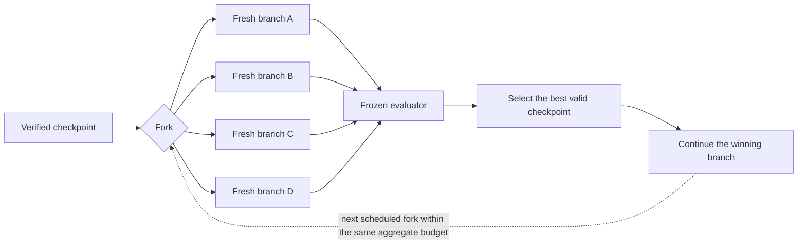

# Idea-Basin Fork-and-Flush

A portable skill for running **budget-matched Fork-and-Flush searches** in Codex
or Claude Code. It gives an agent a reproducible way to explore several
independent approaches, keep the best verified checkpoint, and account for the
entire shared budget.

An optional second workflow builds a validated map of the mechanisms explored
during the search. The map is for analysis and navigation; it never replaces
the task's real evaluator.

> This is an independent implementation inspired by *Fork-and-Flush: Escaping
> Idea Basins in Autoresearch Agents* (Cai et al., arXiv:2610.07447v1). It is not
> the authors' official harness.

## The idea in one minute

Ordinary long-running agents can become attached to one approach. Fork-and-Flush
periodically gives several fresh agents the same verified checkpoint and the
same task, but no inherited discussion history. Each branch explores
independently. A frozen evaluator then decides which checkpoint should continue.



The package provides the deterministic control layer:

- an exact branch schedule and aggregate budget ledger;
- immutable checkpoint and evaluation records;
- validation and best-ever checkpoint selection;
- append-only, resumable run artifacts;
- optional idea-map construction and diagnostics.

Codex or Claude Code still creates the isolated workspaces and fresh sessions
using the host capabilities available in that runtime. The controller records
those actions instead of pretending to expose a universal session API.

## When to use it

Use this skill when all of the following are true:

- the task has a reproducible numeric evaluator;
- candidate states can be saved as checkpoints;
- several independent approaches can be tried within one total budget;
- you want to audit every branch, failure, selection, and unit of compute.

Typical examples include program optimization, architecture search, scientific
fitting, geometric optimization, and long-horizon research agents.

Do not use it as a substitute for an evaluator on subjective work. Do not use a
basin label or map coordinate as a quality score.

## Install

```bash
git clone https://github.com/YaroslavPelekhov/idea-basin-fork-and-flush.git
cd idea-basin-fork-and-flush
python3 -m pip install -r requirements.txt
```

Install the skill for both runtimes:

```bash
python3 scripts/install.py --target both
```

Default destinations:

| Runtime | Installation directory |
|---|---|
| Codex | `~/.agents/skills/idea-basin-fork-and-flush` |
| Claude Code | `~/.claude/skills/idea-basin-fork-and-flush` |

Install only one runtime or choose a custom directory:

```bash
python3 scripts/install.py --target codex
python3 scripts/install.py --target claude
python3 scripts/install.py --target codex --codex-dir /custom/skills
```

The installer will not overwrite a modified installation unless `--replace` is
provided. Replacement first creates a timestamped backup outside the skill
directory.

## Quick start: run a search

### 1. Freeze the run contract

The example below maximizes a score under a shared budget of one million tokens:

```bash
python3 scripts/fnf.py init-run \
  --run-dir runs/circle-packing \
  --task-id circle-packing-9 \
  --budget 1000000 \
  --unit tokens \
  --direction max \
  --evaluator "python3 evaluate.py"
```

This creates the schedule, contract, event ledger, checkpoint ledger, selection
directory, and evidence directory. The contract freezes the evaluator, score
direction, budget, model settings, snapshot, and other selection-relevant facts.

Supported budget units are `tokens`, `credits`, and `cost-microusd`. Both
`--direction max` and `--direction min` are supported.

### 2. Create the branches

Ask Codex or Claude Code to use the installed skill. The coordinator creates a
separate writable workspace and a genuinely fresh conversation for each branch.
All branches receive the same task facts, evaluator, constraints, and checkpoint;
they do not receive the parent reasoning or sibling results.

The default paper-style schedule uses four branches, fork points at 0%, 33%, and
66% of aggregate budget, and roughly 6% of the total budget per branch episode.
Override it only when the experiment requires a different preregistered schedule:

```bash
python3 scripts/fnf.py plan \
  --budget 1000000 \
  --unit tokens \
  --branches 4 \
  --branch-fraction 0.06 \
  --triggers 0 0.33 0.66
```

### 3. Record verified checkpoints

Each checkpoint is a JSON record with its lineage, score, artifact, evidence,
digest, and cumulative aggregate usage:

```json
{
  "checkpoint": "round-1-worker-2-c004",
  "lineage": "round-1-worker-2",
  "parent": "leader-c017",
  "round": 1,
  "score": 12.5,
  "valid": true,
  "artifact": "/absolute/path/checkpoint.tar",
  "artifact_sha256": "...",
  "evidence": "/absolute/path/evaluation.json",
  "cumulative_usage": 43100,
  "usage_kind": "measured"
}
```

Append it to the run ledger:

```bash
python3 scripts/fnf.py record-checkpoint \
  --run-dir runs/circle-packing \
  --json checkpoint.json \
  --require-files
```

### 4. Select and continue

```bash
python3 scripts/fnf.py select \
  runs/circle-packing/checkpoints.jsonl \
  --direction max \
  --budget 1000000 \
  --require-files

python3 scripts/fnf.py status --run-dir runs/circle-packing
```

Selection happens only among valid checkpoints reached inside the declared
budget. The best checkpoint reached anywhere in a lineage is considered, not
only the lineage's final mutable state. Exact ties preserve the incumbent.

## What a run stores

```text
run/
├── contract.json        # frozen experiment contract
├── schedule.json        # exact branch allocation
├── events.jsonl         # append-only lifecycle and usage events
├── checkpoints.jsonl    # every valid and invalid checkpoint record
├── selections/          # round decisions and discarded alternatives
├── evidence/            # raw frozen-evaluator outputs
└── maps/                # optional idea-map outputs
```

Failed and cancelled episodes remain in provenance. Usage is explicitly marked
as `measured`, `estimated`, or `mixed`; an estimate is never silently presented
as a hard billing limit.

## Optional: build an idea-basin map

The mapping workflow answers a different question: **what kinds of mechanisms
did the search explore, and how did branches move between them?**

```text
graded artifacts
      -> content deduplication and trajectory sampling
      -> common functional specifications
      -> blinded similarity triplets
      -> held-out ordinal constraints
      -> 2-D t-STE and SOE fits
      -> basin stability and outcome-separation diagnostics
      -> offline HTML dashboard
```

Start by sampling graded artifacts:

```bash
python3 scripts/fnf.py sample-artifacts \
  runs/*/graded-artifacts.jsonl \
  --output analysis/artifacts.jsonl \
  --manifest analysis/sample-manifest.json \
  --max-per-run 51
```

Then create canonical-specification prompts and blinded triplets, collect their
answers through an explicit stdin/stdout model wrapper, and fit the map:

```bash
python3 scripts/fnf.py make-spec-prompts --help
python3 scripts/fnf.py make-triplets --help
python3 scripts/fnf.py run-prompt-batch --help

python3 scripts/fnf.py fit-map \
  --artifacts analysis/artifacts.jsonl \
  --constraints analysis/constraints.jsonl \
  --output analysis/map \
  --clusters auto \
  --holdout 0.2 \
  --restarts 8
```

The map is interpreted only after held-out triplet agreement, clustering
stability, and outcome separation are reported. Weak validation means the map is
only a navigation aid. Coordinates from different fitted maps are not directly
comparable.

## Commands

| Command | Purpose |
|---|---|
| `plan` | Emit an exact Fork-and-Flush schedule |
| `init-run` | Create a frozen run contract and ledgers |
| `record-checkpoint` | Validate and append a checkpoint record |
| `select` | Choose the best valid in-budget checkpoint |
| `status` | Summarize a run |
| `sample-artifacts` | Deduplicate and sample graded trajectories |
| `make-spec-prompts` | Request common functional specifications |
| `make-triplets` | Build blinded ordinal similarity questions |
| `run-prompt-batch` | Run a resumable prompt batch through a model wrapper |
| `fit-map` | Fit t-STE/SOE, basins, diagnostics, and dashboard |
| `doctor` | Check optional scientific dependencies |

Run `python3 scripts/fnf.py COMMAND --help` for complete arguments.

## Verified behavior

The integration suite covers three deliberately different fixtures:

| Fixture | Objective | Budget unit |
|---|---:|---|
| Nine-circle packing | maximize | tokens |
| Route length | minimize | cost in micro-USD |
| DCLM validation | maximize | credits |

Across these fixtures the tests verify that:

- aggregate schedule accounting is exact;
- invalid checkpoints cannot win;
- checkpoints obtained after the budget cutoff are excluded;
- maximize and minimize objectives use the same controller;
- installation, backup, resume, and synthetic mapping paths work.

Run the complete suite:

```bash
python3 -m pip install pytest
python3 -m pytest -q -c /dev/null --confcutdir=tests tests
```

Current result: **17 passed**.

## Repository layout

```text
.
├── SKILL.md                       # instructions loaded by Codex/Claude
├── agents/openai.yaml             # Codex UI metadata
├── scripts/fnf.py                 # deterministic controller and map CLI
├── scripts/install.py             # Codex/Claude installer
├── references/
│   ├── paper-protocol.md          # search protocol and accounting
│   ├── run-records.md             # contracts, ledgers, checkpoints
│   ├── idea-map-protocol.md       # blinded mapping and validation
│   ├── runtimes.md                # Codex and Claude adapters
│   └── schemas.md                 # machine-readable artifact schemas
└── tests/                          # unit and cross-task integration tests
```

## Important guarantees and non-guarantees

The package guarantees deterministic schedule construction, auditable records,
budget-bound selection, checkpoint validation, and explicit evidence provenance
when used as documented.

It does **not** guarantee that branching improves every task, that the runtime
exposes a hard usage counter, or that every search contains meaningful idea
basins. It also does not claim the gains reported in the paper for a new task.

For the complete experimental invariants, read [`SKILL.md`](SKILL.md) and the
documents in [`references/`](references/).
